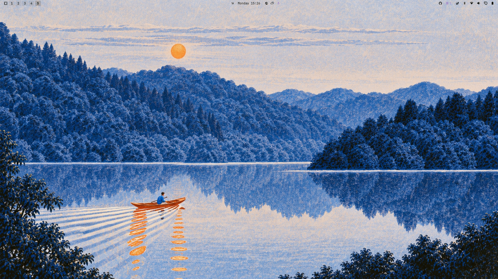

# Blue Lake

A calm, cool-toned dark theme for [Omarchy](https://omarchy.org/) — deep forest-black backgrounds, warm cream text, and lake-blue accents.



## Features

- Deep, low-contrast dark palette that stays easy on the eyes
- Cool blue and cyan accents with a warm cream foreground
- Four lake-inspired wallpapers
- Matching `Yaru-blueaether` icon theme

## Requirements

- [Omarchy](https://omarchy.org/) v4 or newer

## Installation

Install straight from the repository:

```bash
omarchy theme install https://github.com/TheNeovimmer/omarchy-bluelake-theme.git
```

This clones the theme to `~/.config/omarchy/themes/bluelake` and applies it automatically.

Or install it manually:

```bash
git clone https://github.com/TheNeovimmer/omarchy-bluelake-theme.git \
  ~/.config/omarchy/themes/bluelake
omarchy theme set bluelake
```

## Palette

| Role           | Color     |
| -------------- | --------- |
| Background     | `#10130C` |
| Darker         | `#080A06` |
| Lighter        | `#282B24` |
| Foreground     | `#E4CFBF` |
| Accent / Blue  | `#6E7FBF` |
| Cyan           | `#99E2FF` |
| Green          | `#7FD0FF` |
| Magenta        | `#AAA3F7` |
| Red            | `#A48BC7` |
| Yellow         | `#92FFFF` |
| Orange         | `#B29CCF` |
| Muted          | `#6A6D67` |

## Wallpapers

- `lake_wallpaper_1920x1080.png`
- `Serene Moonlit Forest Lake.png`
- `Solitary Rower in a Forested Valley.png`
- `Tranquil Blue Lake at Golden Hour.png`

Cycle backgrounds with:

```bash
omarchy theme bg next
```

## Credits

- Colors generated with Aether for Omarchy v4
- Wallpapers by their respective authors

## License

[MIT](LICENSE) © 2026 TheNeovimmer
